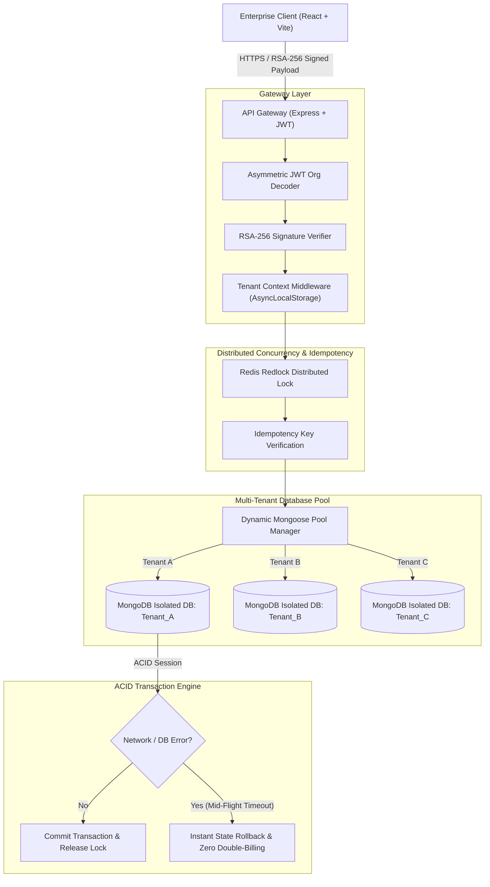

# 🛡️ LedgerGuard: Dynamic Multi-Tenant Zero-Knowledge Billing Engine

[](https://opensource.org/licenses/MIT)
[](https://nodejs.org/)
[](https://www.typescriptlang.org/)
[](https://www.mongodb.com/)
[-red.svg)](https://redis.io/)
[](https://en.wikipedia.org/wiki/Zero-knowledge_proof)

> **Infotact Solutions - 4-Week Enterprise Internship Project**  
> **Domain:** MERN Stack & Cloud Distributed Systems  
> **Cycle:** 5th November 2026 to 5th December 2026  
> **Team:** Rupam Bairagya (Lead), Anish Das, Mistu Naskar, Subhankari Mondal

---

## 📌 Executive Summary & Problem Statement

Enterprise SaaS platforms require strict data isolation and fail-proof financial ledgers. Shared single-database architectures risk catastrophic cross-tenant data leaks between competing clients, while unexpected network timeouts during high-value payment transactions can result in duplicate billing, race conditions, or corrupted ledger records.

**LedgerGuard** solves these architectural challenges by combining:
1. **Dynamic Database Provisioning:** An on-the-fly Mongoose connection pool factory that boots, switches, and disconnects completely isolated MongoDB databases per tenant with zero cross-tenant contamination.
2. **Distributed Idempotent Ledger:** High-performance Redis distributed locks (Redlock algorithm) paired with MongoDB multi-document ACID transactions (`session.withTransaction()`) ensuring instant state rollbacks upon mid-flight network dropouts.
3. **Asymmetric Cryptographic Gateway:** RSA-256 public/private key verification and asymmetric JWT routing preventing unauthorized organization impersonation.
4. **Real-time Analytics Dashboard:** Interactive React & Chart.js client mapping high-frequency usage quotas, active expenditure thresholds, and transaction rollbacks.

---

## 🏗️ High-Level System Architecture



---

## 👥 Team Work Distribution & Ownership Matrix

| Member | Branch | Role & Specialization | Key Modules & Deliverables |
| :--- | :--- | :--- | :--- |
| **Rupam Bairagya** | `rupam-bairagya` | **Team Lead & Frontend Architect** | React 18, Tailwind CSS, Multi-Tenant Dashboard, Tenant Switcher, Billing Ledger Views, Transaction Rollback Visualizer, Chart.js Analytics |
| **Anish Das** | `anish-das` | **Backend & API Gateway Lead** | Express.js API Gateway, Asymmetric JWT Org Decoder, Multi-Tenant Context Middleware (`AsyncLocalStorage`), RSA-256 Route Guard |
| **Mistu Naskar** | `mistu-naskar` | **Database Isolation Specialist** | Dynamic Mongoose Multi-Tenant Connection Pool Factory, Isolated Tenant Bootstrapping, Mongoose Schemas (Tenant, Invoice, Quota), Usage Aggregations |
| **Subhankari Mondal** | `subhankari-mondal`| **Distributed Systems & Locks Specialist** | Redis Redlock Distributed Locking, MongoDB Multi-Document ACID Transactions, Idempotent Financial Ledger Engine, Failure Injection & Rollback Simulator |

---

## 🛠️ Technology Stack

* **Frontend:** React 18, TypeScript, Tailwind CSS, Vite, Chart.js, Lucide Icons, Web Crypto API (RSA-256)
* **Backend:** Node.js (v18+), Express.js, TypeScript, jsonwebtoken, AsyncLocalStorage
* **Database Layer:** MongoDB Atlas / Local Replica Set (ACID Transactions), Mongoose ORM (Dynamic Multi-Tenant Pool)
* **Concurrency & Caching:** Redis 7+, ioredis, Redlock distributed locking algorithm
* **Testing & Benchmarking:** Jest, Supertest, autocannon / k6 stress testing

---

## 🚀 Quickstart Guide

### 1. Prerequisites
* Node.js >= 18.0.0
* MongoDB (Replica Set required for ACID transactions)
* Redis Server running on `localhost:6379`

### 2. Installation
```bash
# Clone the repository
git clone https://github.com/Rupam852/LedgerGuard.git
cd LedgerGuard

# Install root dependencies
npm install
```

### 3. Running Services
```bash
# Run Backend API Gateway & Services
cd anish-das && npm run dev

# Run Frontend Enterprise Dashboard
cd rupam-bairagya && npm run dev
```

---

## 📅 4-Week Milestone Roadmap

* **Week 1:** Dynamic Provisioning & Enterprise Dashboard Layout (JWT decoding, Mongoose connection pool factory, authentication).
* **Week 2:** Idempotent Ledger & Multi-Document ACID Transactions (Redis distributed locks, transaction rollback visualizer, Mid-Project Review).
* **Week 3:** Real-time Analytics Pipeline & Chart.js Visualizations (MongoDB aggregation pipelines for hourly resource billing).
* **Week 4:** Cryptographic RSA-256 Zero-Knowledge Verification, Load Benchmarking, CI/CD, and Final Evaluation Defense.

