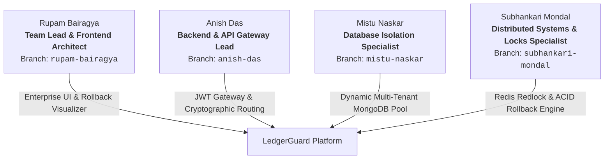

# 📋 LedgerGuard: Comprehensive Team Work Distribution & Ownership Matrix

### Organization: Infotact Solutions
### Project: LedgerGuard: Dynamic Multi-Tenant Zero-Knowledge Billing Engine
### Internship Cycle: 5th November 2026 – 5th December 2026
### Repository: `https://github.com/Rupam852/LedgerGuard.git`

---

## 🏛️ Executive Role & Accountability Matrix

---

## 1️⃣ Rupam Bairagya (Team Lead & Frontend Architect)
* **Branch:** `rupam-bairagya`
* **Direct Responsibility:** Complete Frontend Architecture, Enterprise UI/UX, Chart.js Visualizations & Zero-Knowledge Client Security.
* **Key Deliverables:**
  * Strict-typed React 18 + Vite + Tailwind CSS design system.
  * Enterprise Multi-Tenant Dashboard with dynamic tenant-switching dropdown.
  * Interactive **Transaction Rollback Visualizer Modal** demonstrating live ACID aborts under network timeout simulations.
  * Financial Billing Ledger views with pagination, filtering by transaction status (`COMMITTED`, `ROLLED_BACK`, `PENDING`), and invoice PDF generation.
  * Real-time resource expenditure and quota charts powered by Chart.js.
  * Client-side RSA-256 payload signing via Web Crypto API.

---

## 2️⃣ Anish Das (Backend & API Gateway Lead)
* **Branch:** `anish-das`
* **Direct Responsibility:** Express API Gateway, Asymmetric JWT Decoding, Multi-Tenant Routing Middleware & Cryptographic Validation.
* **Key Deliverables:**
  * High-performance Express.js API gateway with async error handling.
  * Asymmetric JWT authentication middleware extracting `organizationId` and `tenantId`.
  * Node.js `AsyncLocalStorage` tenant context propagation (ensures zero cross-request pollution).
  * RSA-256 cryptographic signature verification middleware guarding payment intake routes.
  * Comprehensive REST API routes for authentication, tenant provisioning, billing, and system metrics.
  * Gateway routing benchmark proving sub-5ms overhead under 2,000 req/sec load.

---

## 3️⃣ Mistu Naskar (Database Isolation & Multi-Tenant Pool Specialist)
* **Branch:** `mistu-naskar`
* **Direct Responsibility:** Dynamic Multi-Tenant MongoDB Connection Pool, Tenant Isolation Architecture & Usage Aggregations.
* **Key Deliverables:**
  * Dynamic Mongoose connection pool factory that boots, switches, and disconnects isolated MongoDB databases per tenant on the fly.
  * Master Catalog schemas: `Tenant`, `Organization`, `UsageQuota`.
  * Isolated Tenant schemas: `Invoice`, `BillingRecord`, `AuditTrail`.
  * High-performance MongoDB aggregation pipelines calculating usage cost metrics over historical scopes.
  * Automated database isolation audit suite proving 100% data separation with zero data leakage.
  * Formal architectural report: `STORAGE_ISOLATION_REPORT.md`.

---

## 4️⃣ Subhankari Mondal (Distributed Systems, Redis Locks & Transaction Atomicity Specialist)
* **Branch:** `subhankari-mondal`
* **Direct Responsibility:** Redis Distributed Locking (Redlock), MongoDB Multi-Document ACID Transactions, Idempotency & Rollback Engine.
* **Key Deliverables:**
  * Enterprise Idempotency engine enforcing unique `idempotencyKey` constraints in Redis and MongoDB.
  * Redlock distributed locking implementation with TTL acquisition, fencing tokens, and automatic release.
  * Multi-document ACID transaction wrapper (`session.withTransaction()`) ensuring financial ledger rollbacks.
  * Failure injection engine simulating mid-flight network timeouts and verifying ZERO duplicate billing.
  * Jest test suite testing 1,000 concurrent duplicate requests with 100% deduplication.
  * Concurrency stress testing benchmark demonstrating zero double-spend under heavy race conditions.

---

## 📊 Evaluation Rubric Alignment

| Infotact Evaluation Milestone | Target Date | Evaluation Focus | Team Milestone |
| :--- | :--- | :--- | :--- |
| **Mid-Project Review (Week 2)** | Nov 19 – Nov 20, 2026 | Database Isolation Audit & State Resiliency | Prove <5ms dynamic DB switching, 100% tenant isolation, and live demonstration of transaction rollback without duplicate billing. |
| **Final Project Review (Week 4)** | Dec 3 – Dec 5, 2026 | Zero-Knowledge Backend & Enterprise Dashboard | Full end-to-end integration, RSA-256 validation, 20-day continuous git streak across all 4 branches, viva defense. |

